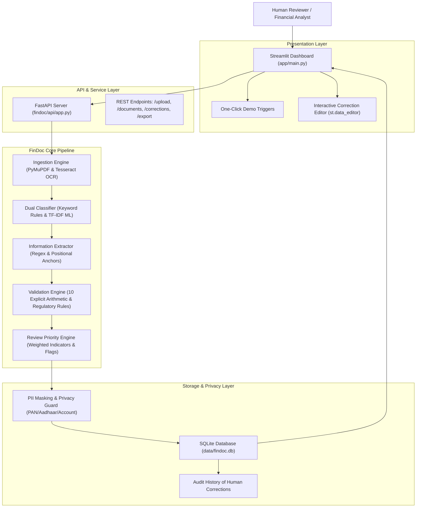
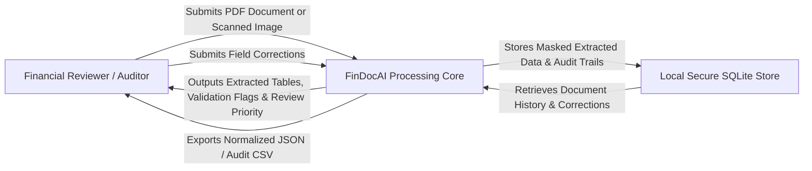
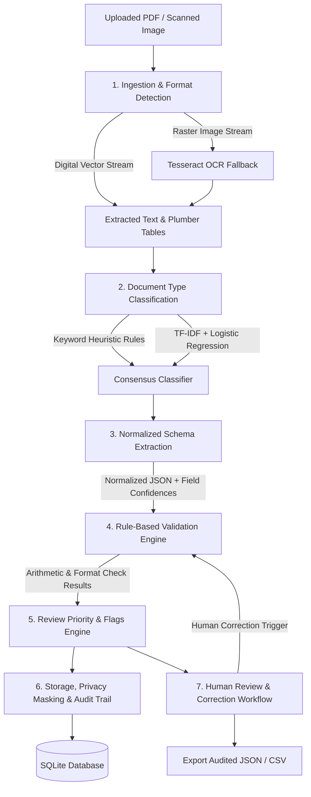
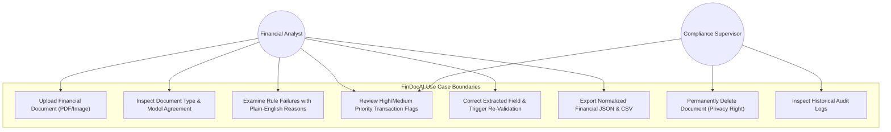
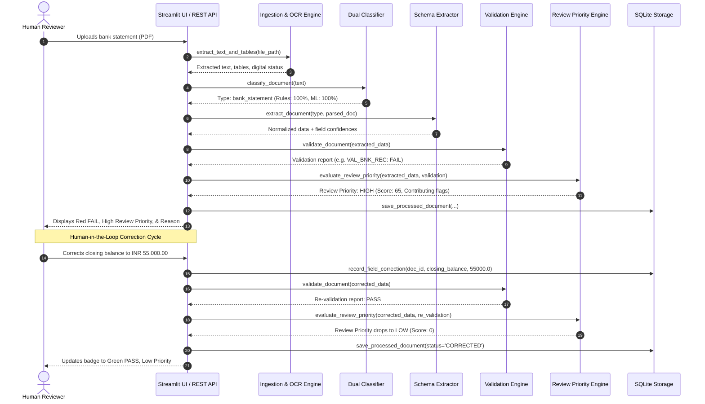
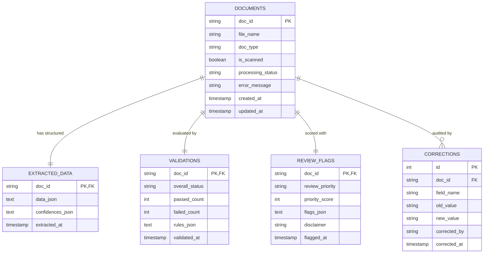

# FinDocAI: System Architecture, Data Flow & Module Design

**Course:** CSET400C Capstone Project, Milestone-2  
**Group ID:** G382 | **SDG Focus:** SDG 9 (Primary), SDG 8 (Secondary)  
**Authors:** Harsh Shukla (`E23CSEU0003`) & Akshita Singh (`E23CSEU0030`)

---

## 1. System Architecture Diagram



---

## 2. Data Flow Diagram Level 0 (Context Diagram)



---

## 3. Data Flow Diagram Level 1 (Pipeline Decomposition)



---

## 4. Use Case Diagram



---

## 5. Sequence Diagram: Document Processing & Human-in-the-Loop Re-Validation



---

## 6. Entity-Relationship (ER) Diagram



---

## 7. Modular Design Architecture

The FinDocAI codebase is architected into single-responsibility, highly decoupled modules:

```
src/findoc/
├── ingest/
│   ├── pdf_parser.py          # PyMuPDF fast digital parsing + pdfplumber tables
│   └── ocr_engine.py          # Tesseract OCR wrapper with graceful failure handling
├── classify/
│   ├── rule_classifier.py     # Keyword heuristic baseline
│   ├── ml_classifier.py       # TF-IDF + Logistic Regression ML classifier
│   └── classifier_service.py  # Dual-model consensus dispatcher
├── extract/
│   ├── schemas.py             # Pydantic normalized schemas, normalizers, PII maskers
│   ├── bank_statement_extractor.py # Bank statements, balances, transaction tables
│   ├── invoice_extractor.py   # Invoices, GSTINs, line items, subtotals, GST
│   ├── kyc_extractor.py       # PAN and Aadhaar identity card extractors
│   └── extractor_service.py   # Routing dispatcher
├── validate/
│   ├── rules.py               # 10 explicit rules returning rule IDs and reasons
│   └── validator.py           # Complete validation suite runner
├── flags/
│   ├── rules.py               # Outlier, duplicate, bounced, cash withdrawal flags
│   └── engine.py              # Review Priority (Low/Med/High) weighted aggregator
├── storage/
│   ├── db.py                  # SQLite CRUD with foreign keys & audit logging
│   └── privacy.py             # Data sanitization, PII masking, deletion
└── api/
    └── app.py                 # FastAPI REST API
```
